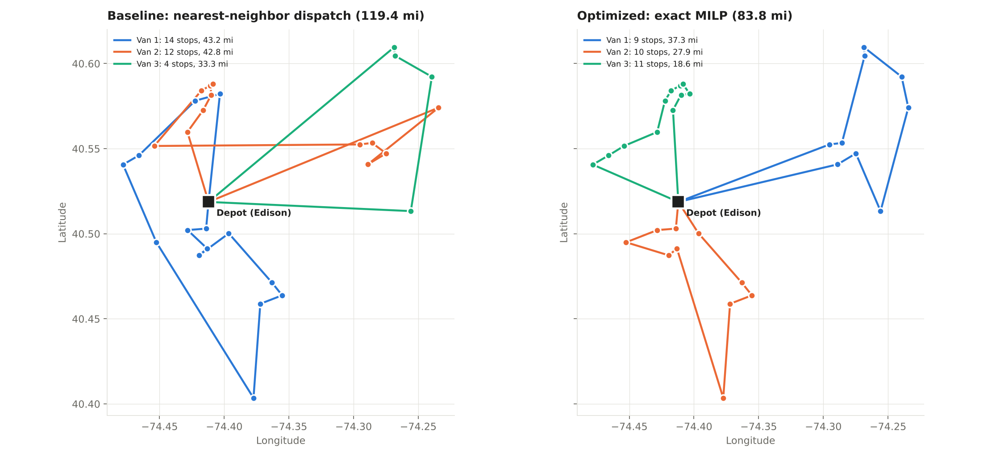
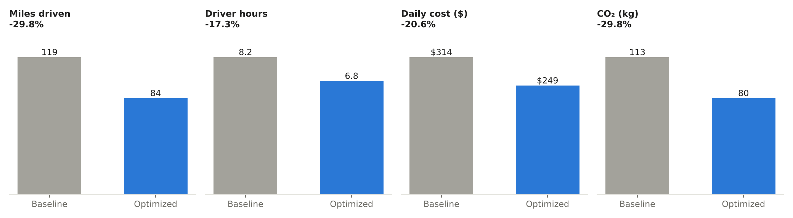

# NJ Last-Mile Route Optimization

**Cutting delivery miles by 30% for a Central New Jersey delivery station with vehicle-routing optimization in Python.**

A station dispatches vans from Edison, NJ to 30 commercial stops across Middlesex and Union counties. This project plans the same delivery day three ways: a simple nearest-stop dispatch rule, a classic routing heuristic, and an exact mixed-integer program. It then compares them on the numbers an operations manager tracks: miles, driver hours, cost, van utilization and CO₂.



## Results

| Plan | Vans | Miles | Driver hours | Daily cost | CO₂ (kg) | Solve time |
|---|---:|---:|---:|---:|---:|---:|
| Baseline: nearest-neighbor dispatch | 3 | 119.4 | 8.22 | $313.73 | 113.4 | < 0.01 s |
| Heuristic: Clarke-Wright + local search | 3 | 84.2 | 6.82 | $249.89 | 80.0 | < 0.01 s |
| **Optimized: exact MILP (proven optimal)** | **3** | **83.8** | **6.80** | **$249.07** | **79.6** | 9 s |



**Key findings**
- **29.8% fewer miles and 20.6% lower daily cost** than nearest-neighbor dispatch: $64.66 saved per day, or about **$16,800 per year** over 260 operating days for this one delivery wave.
- **Peak season (+30% volume):** the gap widens. Optimized routes drive **35.3% fewer miles** (137.2 → 88.8) and save $88.19 per day. Peak volume needs a 4th van either way.
- **The heuristic is within 0.5% of optimal** (0.45% on a normal day, 0.23% at peak) and runs instantly. That's what lets real dispatch systems scale to hundreds of stops, where exact methods become too slow. The exact model's job here is to *prove* how good the fast method is.
- **Nearest-neighbor fails in a predictable way.** It does well early in the route, then strands distant stops at the end, which forces long empty legs back to the depot (see Van 3 in the baseline map).

## Approach

1. **Data:** a synthetic delivery day of 30 stops around 12 Middlesex/Union County towns, with a skewed package mix (mostly small drops, a few large business deliveries). Generated with a fixed seed, so every run is reproducible. No real customer or employer data is used.
2. **Distances:** haversine (great-circle) miles × a 1.3 road-circuity factor, a standard planning approximation when no road-network API is available.
3. **Baseline:** greedy nearest-neighbor. Drive to the closest stop that still fits in the van; when nothing fits, return to the depot.
4. **Heuristic:** the [Clarke-Wright savings algorithm](https://en.wikipedia.org/wiki/Vehicle_routing_problem), improved with inter-route *relocate* moves and *2-opt* within each route.
5. **Exact model:** a two-index capacitated VRP solved with [HiGHS](https://highs.dev/) through `scipy.optimize.milp`:

   ```
   minimize    Σ d_ij · x_ij
   subject to  each stop has exactly one arrival and one departure
               vans leaving the depot = vans returning, within fleet limits
               Σ_{i,j ∈ S} x_ij ≤ |S| − ⌈demand(S) / capacity⌉   for stop sets S
               x_ij ∈ {0, 1}
   ```

   The last constraint family (rounded capacity cuts) is exponentially large, so cuts are added **lazily**. The model is solved, then checked for subtours or overloaded vans, the violated cuts are added, and it is solved again until the plan is feasible, which proves it optimal. The normal day converges in 36 rounds.

6. **Metrics:** service time is 4 min per stop + 15 s per package, with an average speed of 25 mph. Costs use $0.70/mile for fuel and maintenance plus $28/hour for the driver. Every assumption is an editable field in `routeopt/data.py → FleetParams`.

## Run it

```bash
git clone https://github.com/iabdullah42/nj-last-mile-route-optimization.git
cd nj-last-mile-route-optimization
pip install -r requirements.txt

python run.py --skip-peak   # normal day only, ~10 seconds
python run.py               # normal day + peak scenario, ~4 minutes
python run.py --stops 25 --seed 7   # a different day
pytest                      # 9 tests
```

Outputs: `data/stops.csv`, `results/summary.csv`, `results/optimized_routes.csv` and the figures in `results/figures/`.

## Project structure

```
routeopt/
  data.py        synthetic stops + fleet/cost assumptions
  distance.py    haversine and road-mile matrices
  heuristics.py  nearest neighbor, Clarke-Wright, 2-opt, relocate
  exact.py       MILP with lazy capacity cuts (SciPy + HiGHS)
  evaluate.py    feasibility checks and operating metrics
  plots.py       route maps and comparison chart
tests/           feasibility, local-search, cost-math, and an
                 exact-vs-brute-force check on a small instance
run.py           end-to-end pipeline (CLI)
```

## Limitations and next steps

- **Time windows and shift limits:** add delivery windows (VRPTW) and a maximum route length per driver.
- **Real road network:** swap the circuity estimate for drive times from OSRM or a maps API.
- **Scale:** at 100+ stops, use the heuristic (or a metaheuristic such as adaptive large-neighborhood search) as the planner, and keep the MILP for benchmarking.
- **Multi-depot and fleet mix:** different van sizes, plus cost per van-day to trade off fleet size against miles.

## Why I built this

I worked as an industrial engineer and operations/automation project engineer at UPS, and as a logistics manager running a team of up to 15 drivers. Routing decisions like these drive cost in any delivery operation. This project shows the full loop: model the problem, compare methods honestly, and report the result in operating terms.

**Abdullah Ibrahim** · B.S. Industrial Engineering & M.S. Engineering Management, NJIT · [iabdullah42@gmail.com](mailto:iabdullah42@gmail.com)

*MIT License*
